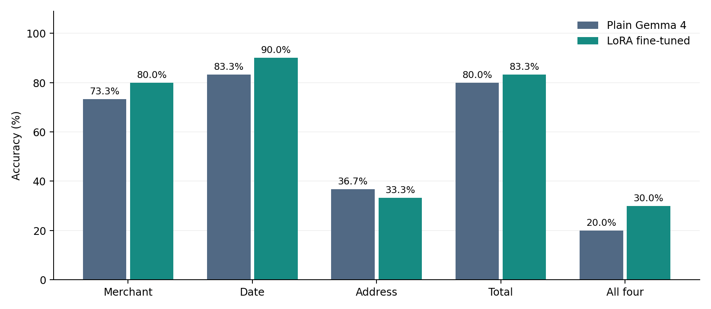
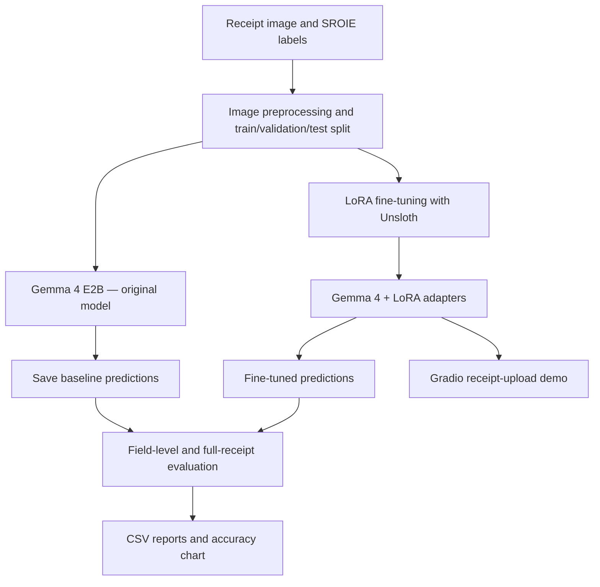

# ReceiptLens — Receipt Information Extraction with Gemma 4

**Turning receipt images into structured data with an open-weight vision-language model and LoRA fine-tuning.**

ReceiptLens is a Python-based experiment and interactive demo that extracts **merchant name, date, address, and total** from scanned receipts. It fine-tunes **Google Gemma 4 E2B** using **Unsloth + LoRA**, then compares the adapted model with the original model on the same receipt images.

Built for **HacktoberFest Hack Day — Open-Source AI, Theme 3B: Receipt Information Extraction**.

ReceiptLens is a Python-based experiment and interactive demo that extracts **merchant name, date, address, total amount, receipt/transaction number, and contact number** from scanned receipts. It fine-tunes **Google Gemma 4 E2B** using **Unsloth + LoRA**, then compares the adapted model with the original model on the same receipt images.

Built for **HacktoberFest Hack Day — Open-Source AI, Theme 3B: Receipt Information Extraction**.

> **Experimental project, not production-ready OCR.** Results below are from a 30-receipt evaluation shared from a Colab run. On a 30-receipt test sample, complete extraction accuracy improved from 20% to 30%, with improvements in merchant, date, and total extraction.

**Tech Stack:** Python, Gemma 4 E2B, Unsloth, LoRA, Hugging Face, PyTorch, Google Colab, and Gradio

## Key Features:

- AI-powered receipt information extraction
- Fine-tuned multimodal vision-language model
- Editable extracted fields and JSON/CSV exports
- Receipt history and spending analytics dashboard
- Baseline vs. fine-tuned model evaluation
- Parameter-efficient training using LoRA

## Highlights

- **Multimodal extraction:** receipt image + instruction → structured JSON
- **Parameter-efficient adaptation:** 4-bit Gemma 4 E2B with LoRA adapters
- **Reproducible experiment:** separate training, validation, and test examples; fixed inference settings
- **Fair comparison:** evaluate the original and adapted model using the same scoring logic
- **Detailed metrics:** JSON validity, individual field accuracy, and complete-receipt accuracy
- **Interactive demo:** Gradio receipt uploader and model-output comparison when supported
- **Modular implementation:** reusable data, inference, training, metrics, and reporting components

## Results

An initial evaluation on **30 SROIE receipt images** produced the following results:

| Metric | Original Gemma 4 | Fine-tuned Gemma 4 | Change |
|:--|--:|--:|--:|
| Valid JSON | 100.0% | 100.0% | 0.0 pp |
| Valid schema | 100.0% | 100.0% | 0.0 pp |
| Merchant (`company`) | 73.3% | **80.0%** | +6.7 pp |
| Date | 83.3% | **90.0%** | +6.7 pp |
| Address | **36.7%** | 33.3% | −3.4 pp |
| Total | 80.0% | **83.3%** | +3.3 pp |
| **All four fields correct** | **20.0% (6/30)** | **30.0% (9/30)** | **+10.0 pp** |



**Interpretation:** complete-receipt accuracy increased by **10 percentage points** (a **50% relative improvement**), while address extraction regressed. Although the experiment shows an improvement on this sample, **21 of 30 receipts still had at least one incorrect field**. The test set is small, and these differences are not proof of a robust improvement on new receipt populations.

*Source: evaluation output from the 24 October 2026 Colab run, supplied by the project team. The figure visualizes those reported values; prediction-level CSVs are not included in this source archive.*

## How it works



The model is instructed to return **exactly four string fields**:

```json
{
  "company": "EXAMPLE STORE",
  "date": "24/10/2026",
  "address": "12 MAIN STREET",
  "total": "245.50"
}
```

*Illustrative JSON example, not a claim about any specific receipt.*

## Technology stack

| Component | Technology |
|:--|:--|
| Vision-language model | `unsloth/gemma-4-E2B-it` |
| Fine-tuning | Unsloth, Hugging Face TRL, LoRA / PEFT |
| Model loading | 4-bit quantization |
| Dataset | ICDAR 2019 SROIE via Hugging Face Datasets |
| Interface | Gradio |
| Evaluation and reporting | Python, Pandas, Matplotlib |
| Training environment | Google Colab GPU (T4 when available) |

## Getting started

### 1. Run in Google Colab (recommended)

1. Download this repository as a ZIP, or clone it and create an archive containing the `ReceiptLens_HackDay` folder.
2. Open [Google Colab](https://colab.research.google.com/) and upload `notebooks/ReceiptLens_Colab_Runbook.ipynb`.
3. Select **Runtime → Change runtime type → T4 GPU** (subject to availability).
4. Run the GPU-check cell.
5. At the notebook's project-upload step, upload the **complete project ZIP** so it can extract `src/receiptlens/` into the Colab workspace.
6. Follow the notebook cells in order: **setup → dataset → baseline → LoRA training → evaluation → Gradio demo → exports**.

> **Note:** The notebook is the primary entry point. The included Python modules are designed to run within its Colab workflow; there is no standalone CPU model server in this repository.

### 2. Run lightweight tests locally (no GPU)

Requires Python 3.10+.

```bash
python -m pip install -r requirements-local.txt
python -m pip install -e .
python -m pytest -q
python -m receiptlens.smoke
```

Local tests check parsing, data preparation, and evaluation logic. They **do not** perform model inference or verify GPU training.

## Dataset and training

The project uses [ICDAR 2019 SROIE](https://huggingface.co/datasets/jsdnrs/ICDAR2019-SROIE), a labeled receipt-image dataset. The published split contains **626 training** and **361 test** examples; verify the loaded split sizes when reproducing the experiment.

The codebase's initial configuration is:

| Setting | Configured value |
|:--|--:|
| Training images | 160 |
| Validation images | 20 |
| Comparison images | 30 |
| Max image edge | 960 px |
| LoRA rank / alpha | 8 / 8 |
| Training steps | 40 |
| Learning rate | `2e-4` |
| Batch size / gradient accumulation | 1 / 4 |
| Inference | Greedy (`do_sample=False`) |

These are **repository defaults**, not independently verified hyperparameters from the completed training run. For reproducibility, save the actual Colab `experiment_config.json`, logs, and prediction CSVs with each run.

**Evaluation protocol:** use disjoint training/validation/test receipts; save plain-model outputs before attaching LoRA; compare the same test images using the same prompt, preprocessing, and decoding settings. The scorer uses task-specific normalized matching for dates, totals, and text. See [`docs/EVALUATION_PROTOCOL.md`](docs/EVALUATION_PROTOCOL.md).

## Repository structure

```text
ReceiptLens_HackDay/
├── notebooks/ReceiptLens_Colab_Runbook.ipynb
├── src/receiptlens/
│   ├── config.py       # Experiment configuration
│   ├── data.py         # Load / preprocess / format receipts
│   ├── prompts.py      # Image extraction instruction
│   ├── vision.py       # Model loading and inference
│   ├── train.py        # Unsloth vision LoRA trainer
│   ├── extract.py      # JSON parsing and validation
│   ├── metrics.py      # Accuracy and paired comparisons
│   ├── reports.py      # CSV and chart exports
│   ├── demo.py         # Gradio application
│   └── smoke.py        # CPU-only smoke test
├── tests/              # Unit and mock end-to-end tests
├── docs/               # Quickstart, protocol, troubleshooting
├── assets/             # README figures
├── outputs/            # Runtime outputs (ignored by Git)
├── requirements-local.txt
├── pyproject.toml
└── LICENSE.txt
```

## Limitations and next steps

- **Address extraction is the biggest weakness.** Investigate truncation, OCR-like character errors, image resolution, and annotation differences.
- **A 30-image evaluation is preliminary.** Repeat on a larger untouched test set and report uncertainty.
- **Not all receipt types are represented.** SROIE results may not transfer to handwritten, damaged, photographed, or Indian tax receipts.
- **Valid JSON ≠ accurate fields.** Human review is still necessary for financial records.
- **Future experiments:** stronger image preprocessing, validation-only hyperparameter selection, field-level error analysis, prompted/no-fine-tuning baselines, and optional line-item extraction.

## Acknowledgments and references

- [Hack Day Theme 3 problem statement](https://github.com/mithun-srinivas/HacktoberFest-HackDay/blob/main/problem-statements/03_fine_tuning.md)
- [Organizer's Gemma fine-tuning starter](https://github.com/mithun-srinivas/HacktoberFest-HackDay/blob/main/templates/03_fine_tuning_starter_kit.ipynb)
- [Unsloth Gemma 4 vision notebook](https://github.com/unslothai/notebooks/blob/main/nb/Gemma4_(E2B)-Vision.ipynb)
- [SROIE dataset](https://huggingface.co/datasets/jsdnrs/ICDAR2019-SROIE)

## License

Original ReceiptLens scaffold code is distributed under the [MIT License](LICENSE.txt). The Gemma model, SROIE dataset, third-party libraries, and upstream notebooks have their **own licenses and terms**. No model weights or training receipts are redistributed here.
